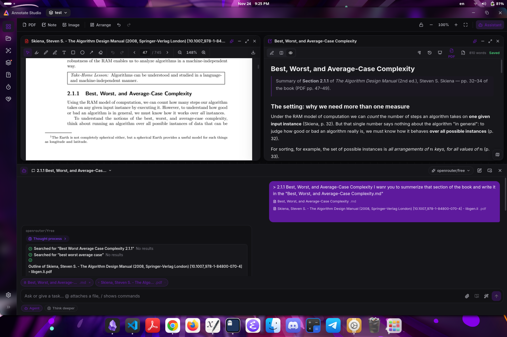

# Annotate Studio



Read, annotate, and remember in one place.

Annotate Studio is a local-first desktop app for studying. Instead of jumping between a PDF reader, a note app, flashcard software, and AI chat windows, you can keep everything in one workspace.

Your files stay on your computer. You can run AI completely offline with Ollama, or connect your own API keys when you want cloud models.

## What you can do

### Study Canvas
Put your PDFs, notes, and images side by side on an open canvas and organize them into separate workspaces for each class or topic. You can highlight and draw on PDFs, take notes next to them, and zoom in or out smoothly.

### Notes and Math
Write in Markdown with LaTeX math, or edit full `.tex` files with a live preview and one-click PDF export. Equations, theorem blocks, callouts, and footnotes work out of the box, and every note keeps a lightweight revision history so you can see diffs and roll back whenever you want.

### Persian and Right-to-Left Support
Persian, Arabic, and mixed Persian-English text works naturally in both the editor and preview. Formulas and code stay left-to-right inside Persian sentences, and search matches Persian and Arabic letter forms together.

### AI Study Assistant
Chat with your notes and PDFs, or let the assistant work across your workspace to search, organize, and draft material.
- Summarize chapters, compare concepts, build timelines, create mind maps, or generate cheat sheets.
- Turn scanned PDFs and images into editable notes with OCR.
- Combine multiple files into a single structured study booklet.
- Review any file edits with collapsible diffs and undo or revert prompts anytime.
- Use a fast model for everyday tasks and a stronger model for hard questions or proofs.

### Flashcards and Spaced Repetition
Create flashcards by hand or generate them from your study material. Cards are scheduled with spaced repetition so tough topics come back sooner while familiar ones space out.

### Practice Exams
Build or generate practice exams with both multiple-choice and written questions. Written answers can be checked and graded by AI with feedback.

### Focus and Support
Includes a built-in Pomodoro timer for study sessions and a Motivation space where you can talk through exam stress, burnout, or study plans.

### Flexible AI and Privacy
Connect local models through Ollama or add providers like OpenAI, Anthropic, and Gemini, with optional proxy support in Settings. AI is completely optional, and your data never leaves your machine unless you send a request to a cloud provider.

## Installation

Pre-built binaries are available in the **GitHub Actions** workflow artifacts. Download the latest build for your platform from the most recent successful run.

## Building from Source

```bash
git clone --depth 1 https://github.com/annotate-studio/annotate-studio
cd annotate-studio
npm install
cargo install tauri-cli
cargo tauri dev
```

To build a release bundle, run `cargo tauri build`.

## Project Status

Annotate Studio is an active open-source project. Much of the early codebase was built quickly with AI assistance, and we are steadily cleaning it up, improving performance, and making the architecture simpler and more reliable.

## What's Next

- Turning study material into clean presentations
- Exporting and editing Office-compatible documents like PPTX and DOCX

## Credit

Annotate Studio was started by [Taha Dostifam](https://github.com/tahadostifam) to bring all study tools together in one place without needing five different apps or handing notes over to the cloud.

Special thanks to [CluvexStudio](https://github.com/CluvexStudio) for all the testing, feedback, and care put into making Annotate Studio better.

## License and Contributing

Annotate Studio is open source under a custom [license](https://github.com/annotate-studio/annotate-studio/blob/main/LICENSE). Issues and pull requests are welcome.
